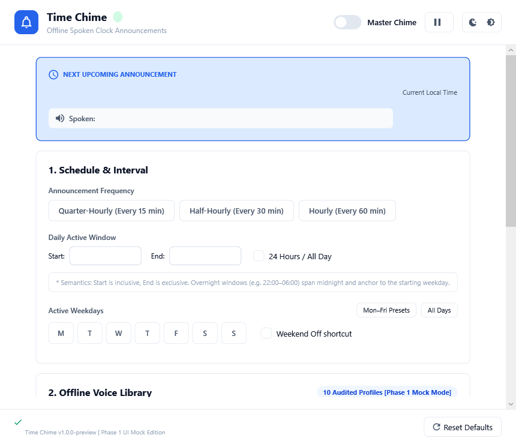

# Time Chime 🔔

<p align="center">
  
</p>

<p align="center">
  <strong>A modern, offline, spoken wall-clock chime utility for Windows.</strong>
</p>

<p align="center">
  
  
  
  
  
</p>

---

## Overview

**Time Chime** is a lightweight, single-process Windows desktop application that speaks the time at customizable intervals (every 15, 30, or 60 minutes). It is designed to run quietly in the background in the Windows System Tray, helping you stay mindful of time without pulling your attention away from your work.

<p align="center">
  
  &nbsp;
  
</p>

### Zero Runtime AI Inference
Time Chime delivers neural text-to-speech audio **without bundling heavy AI frameworks** like Python, PyTorch, or ONNX Runtime. All 480 voice announcements are pre-rendered offline using **Kokoro-82M v1.0**, normalized to **-1.0 dBFS**, and streamed directly via native Windows audio.

---

## Features

- 🎙️ **8 High-Fidelity Offline Neural Voices**:
  - **English (6 Voices)**: Heart (US Expressive), Bella (US Warm), Emma (British Formal), Michael (US Rich), Eric (US Grounded), George (British Warm).
    - Phrased with natural 12-hour *"It's..."* announcements (e.g. *"It's nine o'clock."*, *"It's twelve thirty."*, *"It's eleven forty-five."*).
  - **Hindi (2 Voices)**: Alpha (Female Expressive), Omega (Male Natural).
    - Authentic Devanagari grammar with natural time-of-day references (*सुबह, दोपहर, शाम, रात*, e.g. *"अभी सुबह के नौ बज रहे हैं।"*, *"अभी दोपहर के साढ़े बारह बजे हैं।"*).
- 🎚️ **Real-Time Volume & Speed Control**:
  - Direct 16-bit PCM waveform volume scaling ($0\%$ to $100\%$).
  - Linear interpolation time-stretching ($0.5\times$ to $2.0\times$) that preserves standard $24\text{ kHz}$ hardware compatibility across all Windows audio devices (Bluetooth headsets, USB DACs, speakers).
- 🔔 **Pre-Roll Harmonized Bell**:
  - Optional synthesized acoustic chime bell ($880\text{ Hz}$, $1760\text{ Hz}$, $2640\text{ Hz}$ harmonics) that rings gently before the voice speaks.
- ⏰ **Robust Wall-Clock Scheduling**:
  - Top-of-the-minute alignment strictly bound to `:00`, `:15`, `:30`, `:45`.
  - Configurable active windows with full support for overnight shifts (e.g. `22:00` → `06:00`).
  - Day-of-week selection with quick *"Weekdays only"* and *"Weekend off"* toggles.
  - Resilient sleep/wake drift tolerance and duplicate chime suppression.
- 🚀 **Dual Windows Startup Modes**:
  - **Current User only (User Level)**: Runs on login for the current user via `HKCU\Run`.
  - **All Users (System Level)**: Runs automatically whenever *any user* logs into the computer via machine-wide Common Startup (`C:\ProgramData\...`) and `HKLM\Run`.
- 🎨 **Modern Windows Fluent UI**:
  - Dark, Light, and System-adaptive theme modes.
  - Native Windows System Tray integration with Win32 P/Invoke notifications.
  - Single-instance enforcement using Windows named mutex.
- 💾 **Reliable Persistence**:
  - Atomic JSON configuration with automatic `.bak` recovery.

---

## Installation

### Windows Defender SmartScreen ("Windows protected your PC")
> As Time Chime is a free, newly released open-source project, the installer does not carry an expensive commercial code-signing certificate (\$300+/yr). When running `TimeChime-Setup.exe` for the first time, Windows Defender SmartScreen may display an *"unrecognized app"* warning:
> 1. Click **"More info"** on the blue dialog.
> 2. Click **"Run anyway"**.
> 
> *Alternatively: Right-click `TimeChime-Setup.exe` → Select **Properties** → Check **Unblock** at the bottom → Click **Apply**.*

### Option 1: System-Level Installer (Recommended)
Download and run **`TimeChime-Setup.exe`**:
- Installs machine-wide to `C:\Program Files\Time Chime`.
- Prompts for Administrator elevation (UAC) to configure All-Users shortcuts.
- Creates Start Menu (`C:\ProgramData\Microsoft\Windows\Start Menu\Programs\Time Chime.lnk`) and Desktop shortcuts.
- Registers in Windows **Installed Apps / Add or Remove Programs** (`HKLM`) with a dedicated uninstaller.

### Option 2: Portable ZIP
1. Download **`TimeChime-v1.0.0-win-x64.zip`**.
2. Extract to any directory on your PC.
3. Run `TimeChime.App.exe`.

---

## Architecture & Solution Structure

```
TimeChime/
├── assets/                        # High-resolution logos, screenshots, and 480 pre-rendered voices
│   ├── screenshots/               # Fluent UI light and dark theme previews
│   └── voices/                    # Bundled 480 pre-rendered Kokoro-82M WAV clips
├── docs/                          # Technical documentation
│   ├── architecture.md            # System architecture & domain boundaries
│   ├── decisions/                 # Architecture Decision Records (ADRs)
│   └── testing/                   # Test strategy & requirements traceability matrix
├── src/
│   ├── TimeChime.Core/            # Domain logic, scheduling calculations, PCM audio scaling
│   │   ├── Audio/                 # AudioPcmProcessor (volume scaling & linear tempo resampling)
│   │   ├── Models/                # TimeChimeSettings, ActiveWindowRule
│   │   ├── Scheduling/            # ScheduleCalculator, AnnouncementFormatter, TimeSlotMapper
│   │   └── Voices/                # VoiceProfile catalog definitions
│   ├── TimeChime.Infrastructure/  # Atomic JSON persistence & backup recovery
│   └── TimeChime.App/             # WPF Fluent UI, MainViewModel, SystemTrayManager, Audio Service
├── tests/
│   └── TimeChime.Core.Tests/      # Automated unit test suite (22 tests)
├── tools/
│   ├── TimeChime.Installer/       # Standalone self-extracting single-file setup wizard
│   └── TimeChime.VoiceGenerator/  # Developer utility for Kokoro-82M offline audio synthesis
└── LICENSE                        # MIT License
```

---

## Building from Source

### Prerequisites
- Windows 10 (Build 19041+) or Windows 11 (x64)
- [.NET 10.0 SDK](https://dotnet.microsoft.com/download)

### 1. Clone Repository
```powershell
git clone https://github.com/musheerkhalid/TimeChime.git
cd TimeChime
```

### 2. Run Automated Tests
```powershell
dotnet test tests/TimeChime.Core.Tests/TimeChime.Core.Tests.csproj
```

### 3. Build & Run Application
```powershell
dotnet run --project src/TimeChime.App/TimeChime.App.csproj
```

### 4. Publish Self-Contained Release
```powershell
dotnet publish src/TimeChime.App/TimeChime.App.csproj -c Release -r win-x64 --self-contained true -p:PublishSingleFile=true -o dist/win-x64/TimeChime
```

### 5. Build Single-File Setup Executable
```powershell
dotnet publish tools/TimeChime.Installer/TimeChime.Installer.csproj -c Release -r win-x64 --self-contained true -p:PublishSingleFile=true -o dist/installer
```

---

## Voice Catalog Details

All audio clips are 16-bit, $24\text{ kHz}$ mono PCM WAV files normalized to $-1.0\text{ dBFS}$.

| Voice ID | Display Name | Gender | Locale | Accent | Unique Slots | Total Files |
|---|---|---|---|---|---|---|
| `af_heart` | **Heart (US Expressive)** | Female | `en-US` | American | 48 (12h format) | 96 (mapped 24h) |
| `af_bella` | **Bella (US Warm)** | Female | `en-US` | American | 48 (12h format) | 96 (mapped 24h) |
| `bf_emma` | **Emma (British Formal)** | Female | `en-GB` | British | 48 (12h format) | 96 (mapped 24h) |
| `am_michael` | **Michael (US Rich)** | Male | `en-US` | American | 48 (12h format) | 96 (mapped 24h) |
| `am_eric` | **Eric (US Grounded)** | Male | `en-US` | American | 48 (12h format) | 96 (mapped 24h) |
| `bm_george` | **George (British Warm)** | Male | `en-GB` | British | 48 (12h format) | 96 (mapped 24h) |
| `hf_alpha` | **Alpha (Hindi Expressive)** | Female | `hi-IN` | Indian | 96 (24h unique) | 96 |
| `hm_omega` | **Omega (Hindi Natural)** | Male | `hi-IN` | Indian | 96 (24h unique) | 96 |

---

## License

- **Software Code**: Licensed under the [MIT License](LICENSE).
- **Voice Assets**: Pre-rendered using [Kokoro-82M v1.0](https://huggingface.co/hexgrad/Kokoro-82M) by hexgrad, licensed under the [Apache License 2.0](https://www.apache.org/licenses/LICENSE-2.0).
