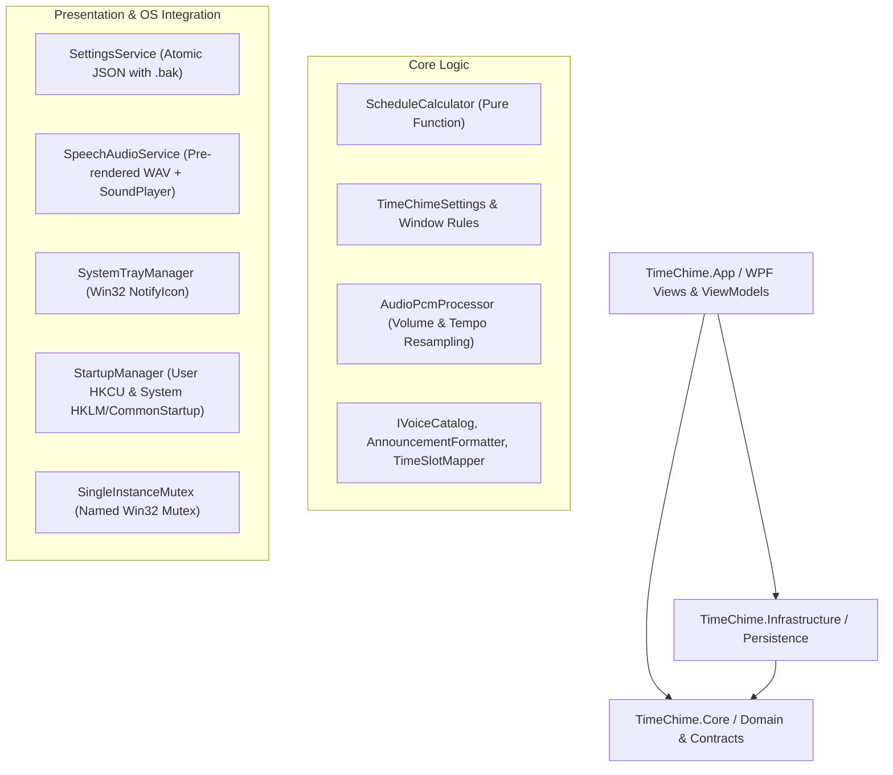

# Architecture Specification: Time Chime

## 1. System Overview
Time Chime is a lightweight, single-process, local desktop utility built for Windows 10/11 using C# on .NET 10.0 and WPF. It operates with zero cloud connectivity, no telemetry, no background service daemons, and no database.

## 2. Project Boundaries

### 2.1 `TimeChime.Core`
- Target: `net10.0`
- Pure domain models, scheduling algorithms, and DSP PCM audio processing.
- Zero references to `System.Windows`, `System.Drawing`, or OS-specific Win32 UI APIs.
- Key Components:
  - `TimeChimeSettings`: Schema-versioned configuration model (`StartupScope`, `FrequencyMinutes`, `VolumePercent`, `SpeedRate`, etc.).
  - `ActiveWindowRule`: Start/End boundary, overnight spanning logic (`Start > End`), all-day flag.
  - `ScheduleCalculator`: Pure scheduling algorithm taking `(DateTimeOffset currentLocalTime, TimeChimeSettings settings) -> DateTimeOffset? nextChimeLocal`.
  - `AnnouncementFormatter`: Localized speech text generation for English (`"It's nine o'clock."`) and Hindi Devanagari (`"अभी सुबह के नौ बज रहे हैं।"`).
  - `TimeSlotMapper`: Maps 24-hour quarter-hour slots to 12-hour canonical audio keys for English voices and 24-hour time-of-day keys for Hindi voices.
  - `AudioPcmProcessor`: In-memory 16-bit PCM sample amplitude scaling (volume) and linear interpolation time-stretching (tempo adjustment while preserving standard 24 kHz sample rate).

### 2.2 `TimeChime.Infrastructure`
- Target: `net10.0`
- Implementation of atomic configuration persistence and backup recovery.
- Key Components:
  - `SettingsService`: Atomic write (`File.WriteAllText(temp)` -> `File.Move/Overwrite`), automatic backup creation (`settings.json.bak`), and corrupted file recovery.

### 2.3 `TimeChime.App`
- Target: `net10.0-windows`
- WPF MVVM Presentation layer and Windows OS integration.
- Key Components:
  - `MainWindow`: Fluent modern shell (780px x 680px, responsive, scrollable).
  - `MainViewModel`: Orchestrates UI state, real-time scheduler loop, preview requests, theme toggles, and status notifications.
  - `SpeechAudioService`: Loads pre-rendered 24 kHz 16-bit PCM WAV clips, synthesizes the optional harmonized pre-roll chime bell (`880 Hz`, `1760 Hz`, `2640 Hz`), applies `AudioPcmProcessor` scaling, and streams via `System.Media.SoundPlayer`.
  - `SystemTrayManager`: Native Win32 system tray icon (`Shell_NotifyIcon`), context menu (Open Settings, Pause/Resume, Chime Now, Exit).
  - `StartupManager`: Dual-mode startup registration supporting User-Level (`HKCU\Run`) and System-Level (`HKLM\Run` + All-Users Common Startup).
  - `SingleInstanceMutex`: Named Win32 mutex preventing duplicate background instances.

## 3. UI Design System & Principles
- **Grid & Spacing**: 8px baseline grid (8, 16, 24, 32px margins/paddings).
- **Typography**: Segoe UI Variable Display / Text (standard Windows 11 typography).
- **Color Palette**:
  - Dark Theme: Background `#1E1E1E`, Card `#2D2D2D`, Border `#3E3E3E`, Accent `#3B82F6` (Electric Blue), Text `#F3F4F6`, Muted `#9CA3AF`.
  - Light Theme: Background `#F9FAFB`, Card `#FFFFFF`, Border `#E5E7EB`, Accent `#2563EB`, Text `#111827`, Muted `#6B7280`.
- **Accessibility**:
  - Interactive elements possess explicit `AutomationProperties.Name` and keyboard tab indices.
  - Vector glyphs (XAML `Path` geometries) scaling cleanly up to 200% DPI.
